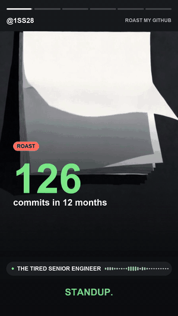

# GitHub Wrapped



*15 seconds of a real 60-second wrap, muted here. The narrator is the `senior` persona.*

Turn your last 12 months on GitHub into a 60-second vertical video. Your year plays out as
animated scenes drawn from your real data (your contribution graph, a 24-hour clock of when you
commit, your actual `git log`, your language bar, your repos), while a narrator voiced with
[Magic Hour](https://magichour.ai) roasts the bad habits, gives real credit for the good ones,
and ranks the year from F to SSS.

**Try it at [github-wrapped-2026.vercel.app](https://github-wrapped-2026.vercel.app)**, or run
it yourself with the command-line tool below.

## Two ways to use it

| | What you get | What you need |
| --- | --- | --- |
| **The website** | Stats, highlights and the script for free. Add your Magic Hour key for the illustrations, the voice and the mp4. | A GitHub account to sign in |
| **The CLI** (`roastmygithub`) | The same video for your own account, with every option below. | Python, ffmpeg, an LLM key and a Magic Hour key |

## Privacy

**The CLI** only roasts the account that owns the GitHub token. There is no `--user` option and
no query that takes a username: everything starts from GitHub's `viewer`. You cannot point it at
someone else.

Counts (commits, streaks, hours, languages) include everything your token can see. Commit
messages and repository names are taken from **public repos only** unless you pass
`--include-private`, because they are sent to the LLM and shown in a video you will post;
private repos appear as "private repo".

**The website** works from public data only. Its GitHub token can read public repositories and
nothing else, so a wrap there never contains private work. Anyone can open a wrap that already
exists; writing a new one needs Sign in with GitHub, and is limited to 3 a day per account and 300
a day across the site. Your Magic Hour key is used for that request only, and the server logs
just a fingerprint of it.

**Opting out:** logins listed in [OPTOUT.md](OPTOUT.md) are never looked up by the website, the
API or the CLI. To add yours, open an issue with the "Opt out" template.

## Quickstart

```bash
pip install -e .
cp .env.example .env        # add LLM_API_KEY and MAGIC_HOUR_API_KEY; GITHUB_TOKEN is optional if `gh` is logged in
roastmygithub doctor
```

Then, in order of cost:

```bash
roastmygithub run --persona professor --dry-run   # stats, highlights and the script; no Magic Hour calls
roastmygithub run --persona professor --preview   # the whole video with a silent track: free
roastmygithub run --persona professor             # the full video: about 340 credits, asks first
```

`--script out/script_professor.json` reuses a script (edit it first if you like) instead of
asking the LLM again. Voice lines and illustrations are cached, so a rerun of the same script is
free. `--title "GitHub Wrapped 2026"` changes the title on every frame.

Narrators: `professor` (a stern, disappointed academic), `hype` (an over-the-top sports
commentator), `senior` (a tired senior engineer reviewing your year).

## Cost

One 60-second wrap with the defaults (`--style wrapped --heroes 2`), in Magic Hour credits:

| Part | Credits |
| --- | --- |
| Voice, 0.1 credit per character (a 60 s script is about 850) | ~85 |
| About 6 illustrations, one per beat (`krea-2`, 10 each) | ~60 |
| 2 animated clips for the opener and finale (4 s image-to-video, 96 each) | 192 |
| **Total** | **~340** |

That is about $0.32 to $0.85 depending on your Magic Hour plan: credit packs buy 400 credits a
dollar, annual plans about 1,000. A real wrap of the author's account came to 344 credits.
`--heroes 0` drops the animated clips (about 145 credits), and `--style data` draws charts
instead of illustrations, which leaves only the voice (about 85).

Before anything is spent, the CLI prints the estimate for your plan and asks.
`--max-credits` refuses any run that would cost more than you set. Cached work is free.

The script is one LLM call: about $0.04 with Claude Sonnet 5.5, or $0.08 with Opus 5.5
(measured 2026-10-20). On the website the site pays for the script and your Magic Hour key pays
for the rest. Everything else is drawn locally with Pillow and ffmpeg.

## Voices

By default each narrator reads in a voice from Magic Hour's AI Voice Generator, and those voices
are impressions of well-known people: David Attenborough for `professor`, Dwayne Johnson for
`hype`, Elon Musk for `senior`. `roastmygithub voices` lists the others and `--voice` picks one.
The script never names the person whose voice is used and never puts opinions in their mouth;
it is a narrator's voice and nothing more. The video credits the voice on screen.

`--voice narrator` uses the persona's own voice instead, which is no real person: Magic Hour's
AI Voice Cloner clones it from a short bundled sample that was itself synthesised with
[Kokoro](https://huggingface.co/hexgrad/Kokoro-82M) (Apache-2.0). `tools/make_voice_samples.py`
rebuilds the samples. `--voice-sample` swaps in your own: only use a voice you have the right
to use.

## Running your own copy of the website

The Python engine runs on Fly.io and the Next.js site on Vercel. [DEPLOY.md](DEPLOY.md) has the
steps, the secrets each side needs, and the checks to run afterwards.

## License

MIT
